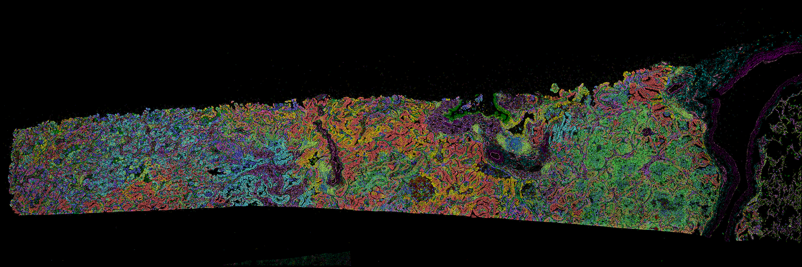
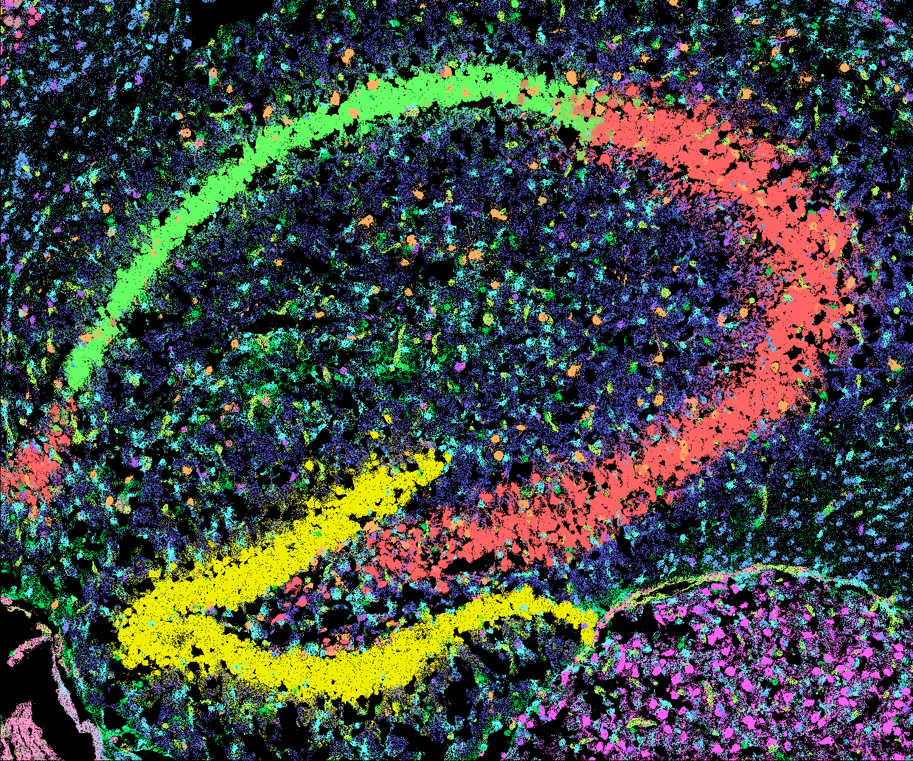
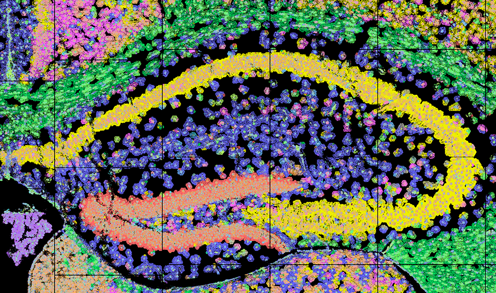
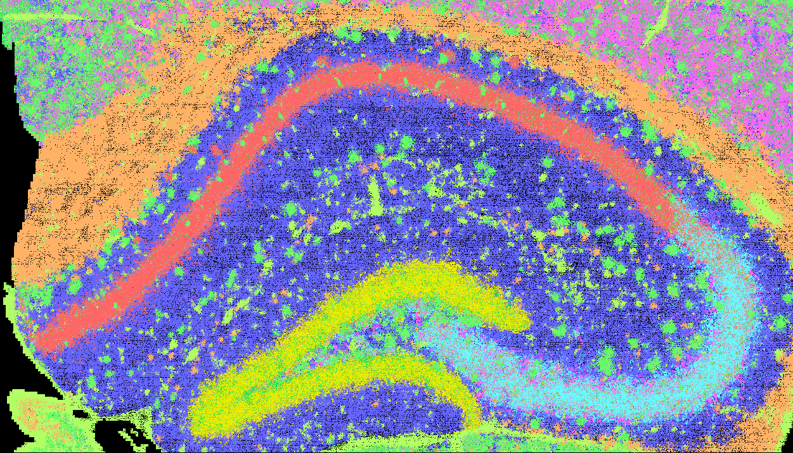
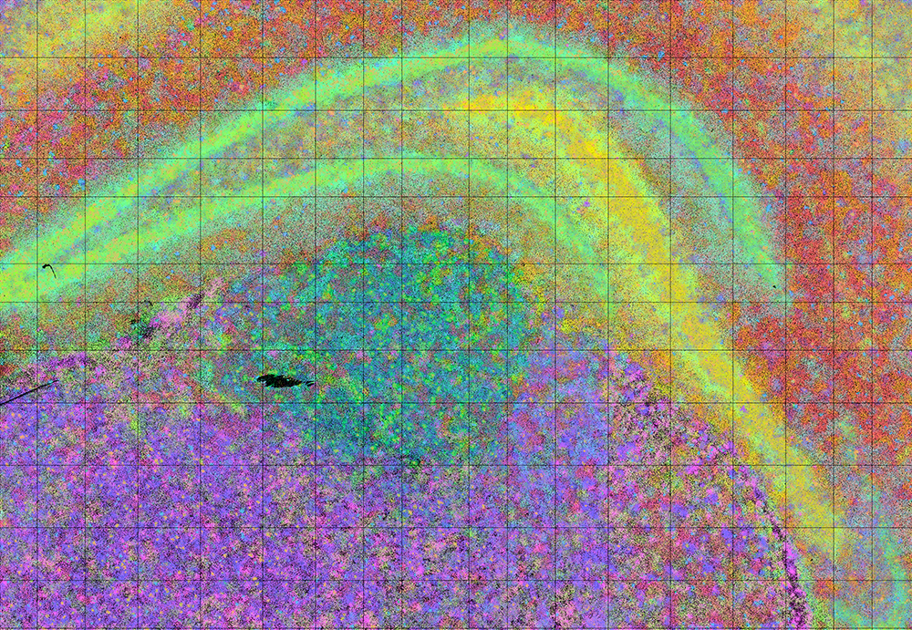
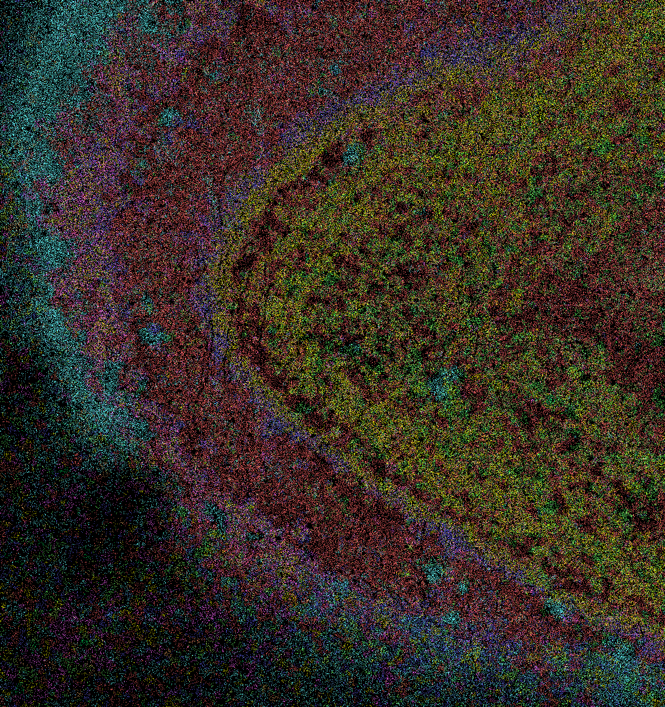

# Guides

These guides show how to process spatial transcriptomics data with [`run_together`](../reference/run_together.md), the recommended way to run `CartLoader`: one command per run that takes raw platform output to deployable CartoScope assets.

New to `CartLoader`? Start with [Get Started](./quickstart/intro.md). For every option of every command, see the [Reference](../reference/intro.md).

!!! question
    - [How do I choose the right tutorial for my platform?](../faq/choose_platform.md)

## run_together Guides

-   <figure markdown="span">
    { width="100%" }
    <figcaption class="figure-caption-vigintro-large">**Single Sample**: one command from raw output to CartoScope assets</figcaption>
    </figure>

    [Read](./pipelines/run_together.md){ .md-button .md-button--primary .button-tight-small }

-   <figure markdown="span">
    { width="100%" }
    <figcaption class="figure-caption-vigintro-large">**Multiple Samples**: one shared model across samples</figcaption>
    </figure>

    [Read](./pipelines/run_together_multi.md){ .md-button .md-button--primary .button-tight-small }

## Platform Tutorials

These tutorials process a small, representative dataset from each platform. Each one starts with the single `run_together` command for that data, then walks through the same analysis step by step with the individual commands.

!!! tip
    For consistency, we use mouse hippocampus when available. Each tutorial begins with data in the platform's native format.

### Imaging-based Platforms

-   <figure markdown="span">
    { width="100%" }
    <figcaption class="figure-caption-vigintro-large">**10x Xenium** Tutorial</figcaption>
    </figure>

    [Read](./subregion_tutorials/xenium.md){ .md-button .md-button--primary .button-tight-small }

-   <figure markdown="span">
    { width="100%" }
    <figcaption class="figure-caption-vigintro-large">**Vizgen MERSCOPE** Tutorial</figcaption>
    </figure>

    [Read](./subregion_tutorials/merscope.md){ .md-button .md-button--primary .button-tight-small }

-   <figure markdown="span">
    { width="100%" }
    <figcaption class="figure-caption-vigintro-large">**CosMx SMI** Tutorial</figcaption>
    </figure>

    [Read](./subregion_tutorials/cosmxsmi.md){ .md-button .md-button--primary .button-tight-small }

### Sequencing-based Platforms

-   <figure markdown="span">
    
    <figcaption class="figure-caption-vigintro-large">**10x Visium HD** Tutorial</figcaption>
    </figure>

    [Read](./subregion_tutorials/visiumhd.md){ .md-button .md-button--primary .button-tight-small }

-   <figure markdown="span">
    { width="100%", height="300" }
    <figcaption class="figure-caption-vigintro-large">**Stereo-seq** Tutorial</figcaption>
    </figure>

    [Read](./subregion_tutorials/stereoseq.md){ .md-button .md-button--primary .button-tight-small }

-   <figure markdown="span">
    
    <figcaption class="figure-caption-vigintro-large">**Seq-Scope** Tutorial</figcaption>
    </figure>

    [Read](./subregion_tutorials/seqscope.md){ .md-button .md-button--primary .button-tight-small }

-   <figure markdown="span">
    { width="100%" }
    <figcaption class="figure-caption-vigintro-large">**Pixel-seq** Tutorial</figcaption>
    </figure>

    [Read](./subregion_tutorials/pixelseq.md){ .md-button .md-button--primary .button-tight-small }

### Any Other Platform

-   <figure markdown="span">
    { width="100%" }
    <figcaption class="figure-caption-vigintro-large">**Generic** Tutorial: any transcript table</figcaption>
    </figure>

    [Read](./subregion_tutorials/generic.md){ .md-button .md-button--primary .button-tight-small }

For the exact inputs `run_together` expects from each platform, see [Platforms](../reference/supported_platforms.md).

## Beyond the Guides

- **Step by step**: run each stage (`sge_convert`, `run_ficture2`, `run_cartload2`, ...) yourself, for custom workflows. See [Step-by-step](./step_by_step.md).
- **Legacy orchestrators**: the older `run_xenium` and `run_visiumhd` pipelines and their end-to-end walkthroughs are kept under [Legacy Orchestrators](../reference/legacy.md); new work should use `run_together`.
