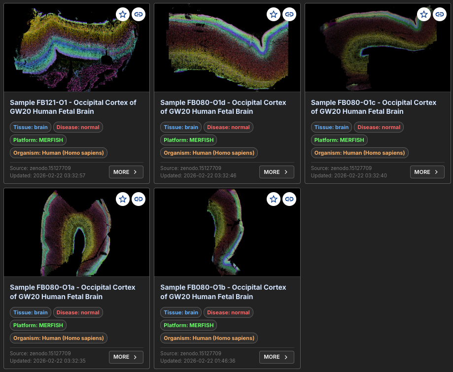

# Human Cortex Multi‑Sample Spatial Factor Analysis Tutorial

This tutorial demonstrates how to run multi‑sample FICTURE analysis and package results with individual commands, starting from the raw data.

!!! question

    - [Why use Multi‑Sample FICTURE Analysis?](../faq/why_multi-sample.md)

!!! tip "Prefer one command?"
    [`run_together`](./pipelines/run_together_multi.md) runs this whole analysis (SGE conversion, one joint FICTURE model, and packaging) from a sample sheet. After [downloading the data](#data-access), from `${work_dir}`:

    ```bash
    sample_ids=(FB080_O1a FB080_O1b FB080_O1c FB080_O1d FB121_O1)
    printf "id\traw_transcript\n" > samples.tsv
    for s in "${sample_ids[@]}"; do
      printf "%s\traw/%s/detected_transcripts.csv\n" "${s}" "${s}" >> samples.tsv
    done

    cartloader run_together \
      --platform merfish \
      --samples samples.tsv \
      --out-dir ./out/walsh2025-human-cortex-fb080-O1 \
      --width 24 \
      --n-factor 96,192 \
      --threads 10 -j 10
    ```

    With Docker, run the same command as `docker run --rm -v ${work_dir}:/data -w /data hyunminkang/cartloader:latest run_together ...`; `-w /data` makes the sheet's relative paths resolve inside the container.

    Each sample is packaged as `out/walsh2025-human-cortex-fb080-O1/cartl/walsh2025-human-cortex-fb080-O1-<sample_id>/`, next to a `multi-catalog.yaml` that links them; `--s3-upload` publishes the whole collection. Its default feature filters differ slightly from the commands below: `Blank-*` probes are dropped at ingest, and `MT-` genes are left out of the factor models.

---

## Input Data

This tutorial uses a series of five human cortex ST datasets from [Walsh et al. Nature 2025](https://www.nature.com/articles/s41586-025-09010-1), generated by MERFISH.

### Data Access

Follow the commands below to download the source data (about 8 GB to download and 29 GB unzipped).

```bash
# Define the work directory
work_dir=/path/to/work/directory
mkdir -p ${work_dir}/raw
cd ${work_dir}/raw

sample_ids=(FB080_O1a FB080_O1b FB080_O1c FB080_O1d FB121_O1)
for s in "${sample_ids[@]}"; do
  wget -O ${s}.zip "https://zenodo.org/records/15127709/files/${s}.zip?download=1"
done

# The FB080_O1* archives hold their files at the top level; FB121_O1 has its own folder
for s in FB080_O1a FB080_O1b FB080_O1c FB080_O1d; do
  unzip ${s}.zip -d ${s}
done
unzip FB121_O1.zip -x '__MACOSX/*'
```

Each sample then has its own folder, `raw/<sample_id>/`, holding `detected_transcripts.csv`, `cell_metadata.csv`, and `cell_by_gene.csv`.

### File Format

!!! info "`detected_transcripts.csv`"

      ```
      ,barcode_id,global_x,global_y,global_z,x,y,fov,gene,transcript_id,cell_id
      36,0,154.75854,8197.335,0.0,1790.1895,303.81055,0,HS3ST1,ENST00000002596,224295401131100634
      53,0,157.40007,8211.97,0.0,1814.648,439.31885,0,HS3ST1,ENST00000002596,-1
      76,0,154.28473,8230.835,0.0,1785.8022,614.0,0,HS3ST1,ENST00000002596,224295401131100700
      ```

      * Column 1: Unique numeric index for each transcript within a field of view (non-consecutive, ascending).
      * `barcode_id`: Zero-based index of the transcript barcode in the codebook; forms a composite key with `fov`.
      * `global_x`: Transcript x coordinates (µm) in the experimental region; may be negative due to alignment.
      * `global_y`: Transcript y coordinates (µm) in the experimental region; may be negative due to alignment.
      * `global_z`: Zero‑based z‑position index.
      * `x`: The x-coordinate of the transcript (µm), within the coordinate space of the field of view.
      * `y`: The y-coordinate of the transcript (µm), within the coordinate space of the field of view.
      * `fov`: Zero-based field of view index; forms a composite key with `barcode_id`.
      * `gene`: Gene name.
      * `transcript_id`: Unique identifier for the transcript.
      * `cell_id`: Unique identifier for cell.

### Define ID and Parameters

```bash
cd $work_dir
# Unique identifier for your collection
COLLECTION_ID="walsh2025-human-cortex-fb080-O1" # change this to reflect your dataset name
sample_ids=(FB080_O1a FB080_O1b FB080_O1c FB080_O1d FB121_O1)

# LDA parameters
train_width=24                           # define LDA training hexagon width (comma-separated if multiple widths are applied)
n_factor=96,192                          # define number of factors in LDA training (comma-separated if multiple n-factor values are provided)
```

The raw coordinates are already in µm, so no scaling is needed.

---

## Example Runs

### Choose Local or Docker Setup

!!! warning "Choose One Mode"
    This tutorial supports two execution modes:

    - local runs (`cartloader` installed on your machine)
    - Docker runs (`docker run hyunminkang/cartloader:latest ...`)

    **Choose one setup mode and complete that setup only.**

    After setup, both modes use the same pipeline commands via the `cartloader_cmd` and `aws_cmd` wrappers.

=== "**Set Up Local Runs**"

    **Set Up Environment**

    

    **Define command wrappers**

    ```bash
    # The work directory as the tools see it
    data_root="${work_dir}"

    # Use the same command shape as Docker mode
    cartloader_cmd() { cartloader "$@"; }
    aws_cmd() { aws "$@"; }
    ```

=== "**Set Up Docker Run**"

    **Set Up Environment**

    

    **Define command wrappers**

    ```bash
    # The work directory as the tools see it: mounted at /data inside the container
    data_root="/data"

    # Use the same command shape as local mode.
    # ~/.aws is mounted (read-only) for the upload step.
    cartloader_cmd() {
      docker run --rm \
        -v "${work_dir}:/data" \
        -v "${HOME}/.aws:/root/.aws:ro" \
        hyunminkang/cartloader:latest \
        "$@"
    }
    aws_cmd() {
      docker run --rm \
        -v "${work_dir}:/data" \
        -v "${HOME}/.aws:/root/.aws:ro" \
        --entrypoint aws \
        hyunminkang/cartloader:latest \
        "$@"
    }
    ```

!!! warning
    All remaining commands are identical for local and Docker runs. Paths given to `cartloader_cmd` and `aws_cmd` start with `${data_root}` (the work directory as the tools see it); plain shell commands, which run on your machine, use `${work_dir}`.

---

### SGE Format Conversion

!!! warning
    Convert each sample transcript file to `CartLoader` SGE format. Commands below process all five samples in a loop.

=== "Recommended: `sge_convert`"

    ```bash
    cd "${work_dir}"

    for sample_id in "${sample_ids[@]}"; do
      cartloader_cmd sge_convert \
        --in-csv "${data_root}/raw/${sample_id}/detected_transcripts.csv" \
        --platform generic \
        --out-dir "${data_root}/sge/${sample_id}" \
        --csv-delim "," \
        --csv-colname-x global_x \
        --csv-colname-y global_y \
        --csv-colname-feature-name gene \
        --csv-colnames-others cell_id global_z \
        --sge-visual \
        --n-jobs "${n_jobs}"
    done
    ```

=== "Fast path: direct transform (no visualization/filtering)"

    !!! tip
        Raw coordinates are already in micrometers. Use this only if you do **not** need SGE visualization or density/feature-based filtering. It runs directly in your shell, in either mode.

    ```bash
    cd "${work_dir}"

    for sample_id in "${sample_ids[@]}"; do
      mkdir -p "${work_dir}/sge/${sample_id}"
      (
        echo -e "X\tY\tgene\tcount\tcell_id\tZ"
        tail -n +2 "${work_dir}/raw/${sample_id}/detected_transcripts.csv" \
          | tr ',' '\t' \
          | perl -lane 'print join("\t",$F[2],$F[3],$F[8],1,$F[10],$F[4]);'
      ) | gzip > "${work_dir}/sge/${sample_id}/transcripts.unsorted.tsv.gz"
    done
    ```

---

### Prepare Input List

Create `input.tsv` (tab-separated, one sample per line). The paths in it are read by `run_ficture2_multi`, so they start with `${data_root}`.

```bash
cd "${work_dir}"

: > input.tsv
for sample_id in "${sample_ids[@]}"; do
  printf "%s\t%s/sge/%s/transcripts.unsorted.tsv.gz\n" \
    "${sample_id}" "${data_root}" "${sample_id}" >> input.tsv
done

cat input.tsv
```

!!! info "Example Input List: `input.tsv`"

    The TSV has **one sample per line**, **no header**, and two columns (in Docker mode the paths begin with `/data`).

    ```text
    FB080_O1a    /path/to/work_dir/sge/FB080_O1a/transcripts.unsorted.tsv.gz
    FB080_O1b    /path/to/work_dir/sge/FB080_O1b/transcripts.unsorted.tsv.gz
    FB080_O1c    /path/to/work_dir/sge/FB080_O1c/transcripts.unsorted.tsv.gz
    FB080_O1d    /path/to/work_dir/sge/FB080_O1d/transcripts.unsorted.tsv.gz
    FB121_O1     /path/to/work_dir/sge/FB121_O1/transcripts.unsorted.tsv.gz
    ```

    * `1st Column` (required, str): Unique sample identifier (avoid whitespace).
    * `2nd Column` (required, str): Path to the transcript-indexed SGE file in `CartLoader` format, generated from the SGE format conversion step above.

---

### Multi-Sample FICTURE Analysis

Train cohort-level LDA models (per width and factor setting), decode each sample, and write the JSON manifests.

The shared models are written to `ficture2/`, each sample's results to `ficture2/samples/<sample_id>/`, and the manifest that links them to `ficture2/ficture.multi.params.json`. See details in [run_ficture2_multi](../reference/run_ficture2_multi.md).

```bash
cartloader_cmd run_ficture2_multi \
  --in-list "${data_root}/input.tsv" \
  --out-dir "${data_root}/ficture2" \
  --width "${train_width}" \
  --n-factor "${n_factor}" \
  --exclude-feature-regex '^(Blank-.*$)' \
  --threads "${n_jobs}" \
  --n-jobs "${n_jobs}"
```

---

### Multi-Sample Asset Packaging

Package every sample into web-ready PMTiles and catalogs. `run_cartload2_multi` finds the samples and the shared models in `ficture2/ficture.multi.params.json`, so it needs no input list.

Each sample is written to its own self-contained directory, `cartload2/${COLLECTION_ID}-<sample_id>/` (with its `catalog.yaml`), and the shared factor files (model, colors, DE, UMAP) and `multi-catalog.yaml`, which links the samples, to `cartload2/`. See details in [run_cartload2_multi](../reference/run_cartload2_multi.md).

```bash
cartloader_cmd run_cartload2_multi \
  --fic-dir "${data_root}/ficture2" \
  --out-dir "${data_root}/cartload2" \
  --id "${COLLECTION_ID}" \
  --threads "${n_jobs}" \
  --n-jobs "${n_jobs}"
```

---

### Upload to AWS

Upload each sample's directory, then `multi-catalog.yaml` and the shared files it lists, into one S3 directory for the collection. See [upload_aws](../reference/upload_aws.md) for options.

```bash
AWS_DIR=s3://your-bucket/${COLLECTION_ID}   # recommended: end with COLLECTION_ID

# 1. Each sample's packaged directory
for sample_id in "${sample_ids[@]}"; do
  cartloader_cmd upload_aws \
    --in-dir "${data_root}/cartload2/${COLLECTION_ID}-${sample_id}" \
    --s3-dir "${AWS_DIR}/${COLLECTION_ID}-${sample_id}" \
    --n-jobs "${n_jobs}"
done

# 2. multi-catalog.yaml and the shared files it lists (the names without a '/')
cd "${work_dir}/cartload2"
for f in multi-catalog.yaml $(grep -E '\.' multi-catalog.yaml | awk '{print $NF}' | grep -v / | sort -u); do
  aws_cmd s3 cp "${data_root}/cartload2/${f}" "${AWS_DIR}/${f}"
done
```

Each sample directory is self-contained, so to share a single sample, run only its `upload_aws` command.

---

## Output Summary

<div class="grid cards generic" markdown>

-   

    ---

    #### View/Explore

    The outputs are available in CartoScope.

    [Explore in CartoScope](https://v3o-main.carto-scope.org/datasets?collections=multi-sample+analysis+of+human+occipital+cortex+%28gw20%29+development){ .md-button .md-button--primary .button-tight-small }

</div>

See output details in the reference pages for [run_ficture2_multi](../reference/run_ficture2_multi.md) and [run_cartload2_multi](../reference/run_cartload2_multi.md).
