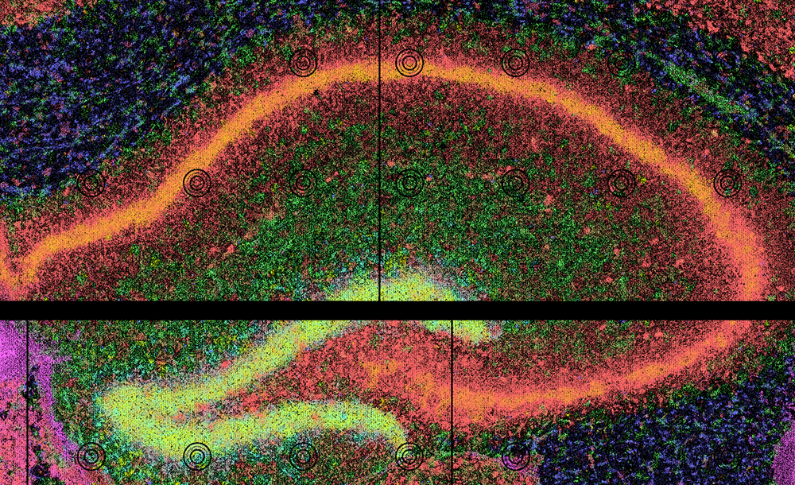

# Quick Start: Run with Docker

This quick start runs [`run_together`](../../reference/run_together.md) inside the prebuilt Docker image, which contains `CartLoader`, every tool it calls, and a small starter dataset.

!!! info "Use Cases"
    The fastest way to try `CartLoader`: nothing to install except Docker, and the first example needs no download.

!!! warning "Requirements"
    - `Docker` on your system (see [Install Docker](#install-docker)).
    - For the second example: about 10 GB of free disk (a 1.5 GB download plus about 8 GB of outputs); it took about 11 minutes on a 12-core laptop with `--threads 4 -j 4`.

!!! question
    - [I am not sure whether to run with Docker or run locally. Which one should I choose?](../../faq/choose_run_mode.md)

---

## Install Docker

If you are new to [Docker](https://www.docker.com/), see the [Docker documentation](https://docs.docker.com/get-started/) for installation and basic usage. Then check that it works:

```bash
docker --version         # Docker is installed
docker run hello-world   # Docker can run containers
```

If these commands fail, [install Docker](https://docs.docker.com/get-docker/) first.

---

## Get the Image

```bash
docker pull hyunminkang/cartloader:latest
```

`latest` always points to the most recent release. For reproducible results, use a dated tag instead (for example `hyunminkang/cartloader:20261007-1432`); every release is listed on [Docker Hub](https://hub.docker.com/r/hyunminkang/cartloader/tags).

**How the image is used:** its entry point is the `cartloader` command, so whatever follows the image name is a `cartloader` subcommand and its options:

```bash
docker run --rm -v <host-dir>:<container-dir> hyunminkang/cartloader:latest <command> [options]
```

- `-v` mounts a directory from your machine into the container. Paths in the options must be the **container** paths.
- `--rm` removes the container when the command finishes; outputs written to a mounted directory stay on your machine.
- To look around inside the image (the repository is at `/app/cartloader`, the starter data at `/app/data`):
  ```bash
  docker run --rm -it --entrypoint bash hyunminkang/cartloader:latest
  ```

!!! note "File ownership on Linux"
    The container runs as root, so on Linux the files it writes are owned by root. Change ownership afterwards if needed, e.g. `sudo chown -R $(id -u):$(id -g) out`.

---

## Example 1: Mouse Hippocampus (preloaded, no download)

### Input

The image contains a mouse hippocampus SGE from Seq-Scope under `/app/data/sge/`, already converted to the `FICTURE`-compatible transcript format by [`sge_convert`](../../reference/sge_convert.md):



The same data is on Zenodo: [seqscope_starter.std.tar.gz](https://zenodo.org/records/17953582/files/seqscope_starter.std.tar.gz).

### Run

```bash
mkdir -p out
docker run --rm -v $(pwd)/out:/out hyunminkang/cartloader:latest \
  run_together \
    --platform seqscope \
    --in-transcript /app/data/sge/transcripts.unsorted.tsv.gz \
    --out-dir /out/seqscope_hippo \
    --id seqscope_hippo \
    --width 18 \
    --n-factor 6,12 \
    --threads 4 -j 4
```

| Option | Meaning |
|---|---|
| `--platform seqscope` | Use the Seq-Scope [platform profile](../../reference/supported_platforms.md) for defaults. |
| `--in-transcript` | An already-converted transcript TSV, so the SGE conversion step is skipped. |
| `--out-dir`, `--id` | Output directory and the sample ID used to name the packaged assets. |
| `--width`, `--n-factor` | `FICTURE` hexagon width (µm) and the number(s) of factors; one model per combination. |
| `--threads`, `-j` | Threads per job and number of parallel jobs. |

### Output

The deployable result is `out/seqscope_hippo/cartl/seqscope_hippo/`: a `catalog.yaml` plus the PMTiles it references (the SGE and one set of factor layers per model). See [Outputs](#outputs) for the full layout.

<div class="grid cards generic" markdown>

-   

    ---

    #### View/Explore

    A packaged version of this dataset is available in CartoScope and on Zenodo.

    [Explore in CartoScope](https://v3o-main.carto-scope.org/dataset?uri=s3%2Fcartostore%2Fdata%2Fbatch%3D2026_02%2Fmouse-brain-test-collection%2Fsubdata_seqscope_n17t89b_c1d2f){ .md-button .md-button--primary .button-tight-small }

    [Download from Zenodo](https://zenodo.org/records/18837725){ .md-button .button-tight-small }

</div>

---

## Example 2: Xenium Human Kidney (full pipeline)

This example starts from raw Xenium output, so every stage runs: SGE conversion, `FICTURE`, two cell analyses (`CartLoader`'s own, from the Xenium cell boundaries, and an import of the Xenium Ranger clusters), the DAPI image, and packaging.

### Input

A human kidney section from [GSE264334](https://www.ncbi.nlm.nih.gov/geo/query/acc.cgi?acc=GSE264334), repackaged in the standard Xenium output layout and hosted on the [AWS Open Data Registry](https://registry.opendata.aws/) (no AWS account needed):

```bash
# with the AWS CLI
aws s3 cp --no-sign-request \
  "s3://cartostore/data/batch=2026_05/xenium-geo-public-dataset-collection/xenium-human-kidney-igan-bull2024-20260516/gse264334-reformatted.tar.gz" .
# or with curl
curl -O "https://cartostore.s3.amazonaws.com/data/batch=2026_05/xenium-geo-public-dataset-collection/xenium-human-kidney-igan-bull2024-20260516/gse264334-reformatted.tar.gz"

tar -xzf gse264334-reformatted.tar.gz    # creates gse264334-reformatted/
```

`run_together` finds the inputs inside the folder by their standard Xenium names: `transcripts.csv.gz`, `cells.csv.gz`, `cell_boundaries.csv.gz`, `analysis/clustering/gene_expression_graphclust/clusters.csv`, and `morphology.ome.tif` (see the [Xenium platform page](../../reference/platforms/xenium.md)).

### Run

```bash
docker run --rm -v $(pwd):/work hyunminkang/cartloader:latest \
  run_together \
    --platform 10x_xenium \
    --in-dir /work/gse264334-reformatted \
    --out-dir /work/out/gse264334 \
    --id gse264334 \
    --bin-count 50 \
    --threads 4 -j 4
```

Without `--width`/`--n-factor`, the Xenium profile's defaults apply (12 µm hexagons; 12, 24, and 48 factors). `--bin-count 50` groups genes into 50 bins for the point layers instead of the default 500, which makes packaging faster for a quick test.

---

## Outputs

`run_together` writes everything under `--out-dir`:

```
<out-dir>/
├── run_together.mk            # the generated Makefile (rerun the command to resume)
├── run_together.resolved.json # the fully resolved configuration of the run
├── mk/                        # per-stage done flags
├── tsv/                       # converted SGE (transcripts, features, coordinate ranges)
├── fic/                       # FICTURE models, factor maps, cell analyses
└── cartl/<id>/                # catalog.yaml + PMTiles  ← the deployable result
```

Upload `cartl/<id>/` to any web-accessible storage to view it in CartoScope, or let `run_together` do it with `--s3-upload` (see [Publishing](../../reference/run_together.md#publishing)).

!!! tip "Interrupted or failed run?"
    Rerun the same command: finished steps are skipped. Add `--restart` to rebuild everything. See [Resume or Restart](../../faq/restart_or_resume.md).

---

## Next Steps

- Run your own data: [platform tutorials](../intro.md#platform-tutorials) and [Specifying Inputs](../../reference/run_together_inputs.md).
- Analyze several samples jointly: [Multiple Samples with run_together](../pipelines/run_together_multi.md).
- Run the stages one at a time: [Step-by-step](../step_by_step.md).
